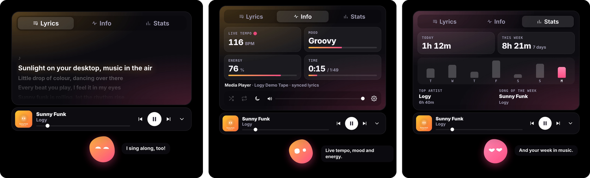
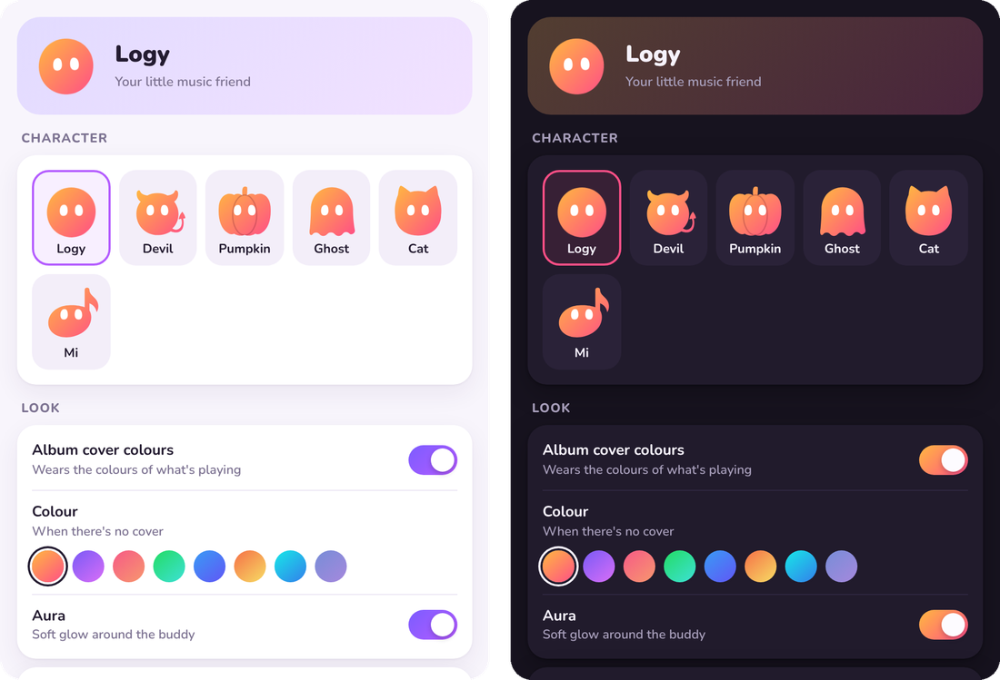

<div align="center">


# Logy

**Your little music buddy for Windows, Mac and Linux.**

A little blob that lives on your desktop and comes alive with the music you are playing:
it dances to the beat, wears the colours of every album cover, sings the lyrics with you and
reacts to everything you do.


### [Download](https://github.com/tomasbarbosa/Logy/releases/latest)

Free · Windows 10 and 11 · macOS 11 or newer · Ubuntu, Debian and friends · No accounts, no sign-in

**New to this? Jump to [How to install](#how-to-install): three short steps for each computer.**

</div>

---

## Wears every song's colours

Logy takes its colours from the cover of the album that is playing. Every song has its own look,
and Logy changes smoothly when the song does. Black, white and grey covers turn it into a
pearl with a soft rainbow sheen, and with no music it wears its own sunset colours.

<p align="center"></p>

## Pick your character

Logy can take another shape: a little devil, a pumpkin, a ghost, a cat or Mi, a musical note.
Whichever you pick, it keeps its colours, its face and all its moves. Change it in the settings
and Logy turns into it right away.

<p align="center"></p>

## Lyrics, tempo and your week in music

Click Logy to open the player. You get **synced lyrics**, line by line, the **live tempo** (BPM),
the song's mood and energy, and your **weekly stats**: time listened, artist of the week and song
of the week. Everything stays on your computer.

<p align="center"></p>

## Lots of interactions and reactions

Logy dances to every beat, gets starry-eyed when your song of the week comes on, gets grumpy if you
poke it too much, takes a bow when a song ends and throws a party when the music drops.

<p align="center"></p>
<p align="center"></p>

## Your buddy, your way

Pause the music and Logy yawns, then falls asleep. When the music comes from a browser (YouTube,
SoundCloud…), it turns into a little browser window. And in the settings you choose its
character, its name, its size, its glow and much more.

<p align="center"></p>
<p align="center"></p>

## And so much more

- **Music controls** without leaving what you are doing: play and pause, previous and next, seek,
  shuffle, repeat, and the volume of the music app alone.
- **Sleep timer**: the music stops after 15, 30 or 60 minutes and Logy falls asleep.
- **Steps aside on its own** during games, fullscreen videos and presentations.
- **Drag it anywhere**: Logy remembers its spot.
- **Party mode** when the music gets intense, and surprises at Christmas, on New Year's Eve and at
  Halloween.
- **Settings** for its character, size, colour, glow, sounds, karaoke, how chatty it is and starting
  with your computer.

## Works with

Spotify (free or Premium), Apple Music, YouTube and other sites in Chrome, Edge, Safari or Firefox,
and any player your computer shows in its media controls (the Windows media controls, the Mac's
Now Playing, or MPRIS on Linux). No sign-in to any service.

## How to install

Go to the **[latest release](https://github.com/tomasbarbosa/Logy/releases/latest)**, scroll down to
**Assets** and download the file for your computer:

| Your computer | Download this file |
|---|---|
| 🪟 **Windows** 10 or 11 | **`Logy_…_x64-setup.exe`** |
| 🍎 **Mac** (Apple chip or Intel), macOS 11 or newer | **`Logy_…_universal.dmg`** |
| 🐧 **Linux**: Ubuntu, Debian, Linux Mint, Pop!_OS… | **`Logy_…_amd64.deb`** |

Then follow the steps for your computer. Once installed, play some music and Logy shows up at
the top of your screen.

### 🪟 Windows

1. Open the **`.exe`** file you downloaded.
2. If a blue window says **"Windows protected your PC"**, click **More info**, then **Run anyway**.
3. Click **Install**. Logy opens by itself and stays in the Start menu.

> [!NOTE]
> That blue warning only shows because Logy isn't signed with a paid certificate yet. It's safe.

To uninstall: **Settings → Apps → Logy → Uninstall**.

### 🍎 Mac

1. Open the **`.dmg`** file you downloaded and click **Agree**.
2. **Drag the Logy icon onto the Applications folder** in the window that opens.
3. Open the **Terminal** app (press <kbd>⌘ Command</kbd> + <kbd>Space</kbd>, type `Terminal`, press
   <kbd>Enter</kbd>), paste this line and press <kbd>Enter</kbd>:

   ```
   xattr -dr com.apple.quarantine /Applications/Logy.app
   ```

   Nothing shows up when it works. Now open **Logy** from your **Applications** folder.

> [!IMPORTANT]
> **Why step 3?** Apple blocks apps that aren't registered with its paid developer programme, and
> recent macOS versions say Logy "is damaged" or "can't be checked". The line above only tells your
> Mac that you trust Logy. You do it once, and again only when you install a new version.
>
> Prefer not to use the Terminal? Try opening Logy, click **Done**, then go to **System Settings →
> Privacy & Security**, scroll down and click **Open Anyway**. Some Macs don't show that button;
> then use the Terminal line.

The first time, macOS asks two things. Click **Allow** for both:
- **Record audio from your Mac**: so Logy can dance to the beat (macOS 14.6 or newer). It only
  listens; nothing is recorded or sent.
- **Control Spotify / Music**: so the volume slider works.

Logy's icon sits in the menu bar at the top, with the settings and **Quit**. To uninstall: quit
Logy and move it from **Applications** to the **Bin**.

### 🐧 Linux

1. Double-click the **`.deb`** file you downloaded. Your software centre opens.
2. Click **Install** and type your password.
3. Open **Logy** from your applications menu.

> [!TIP]
> If double-clicking doesn't open an installer, open the **Terminal** in your Downloads folder and
> run:
> ```
> sudo apt install ./Logy_*_amd64.deb
> ```

For Ubuntu 22.04 or newer, Debian 12 or newer, Linux Mint 21 or newer, Pop!_OS and others based
on them. Logy works on X11 and Wayland desktops; its icon sits in the top bar (on GNOME it needs
the AppIndicator extension, which Ubuntu already has). To uninstall: `sudo apt remove logy`.

## Privacy

- Sound is analysed on your computer, in memory, so Logy can dance. It is never recorded or sent
  anywhere.
- To show lyrics, Logy asks [LRCLIB](https://lrclib.net) for them with the song's title and
  artist. Nothing else is sent, and there are no accounts, ads or data collection.
- Settings and stats stay on your computer.

## Credits

- Lyrics provided by [LRCLIB](https://lrclib.net).
- Not affiliated with Spotify. "Spotify" is a registered trademark of Spotify AB.

## License

© 2026 tomasbarbosa. All rights reserved. Logy is free for personal use; see the
[terms of use](LICENSE).
